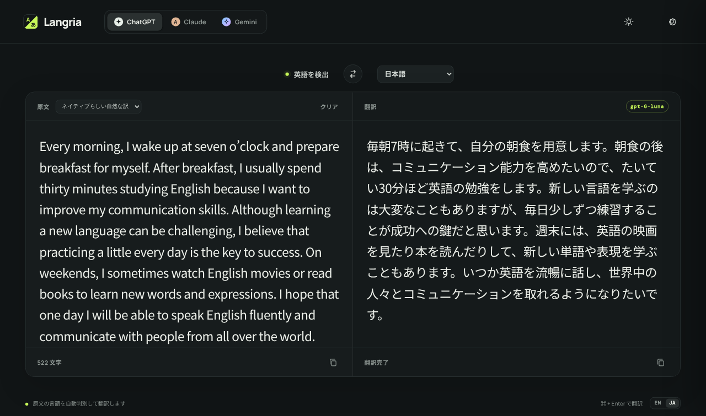
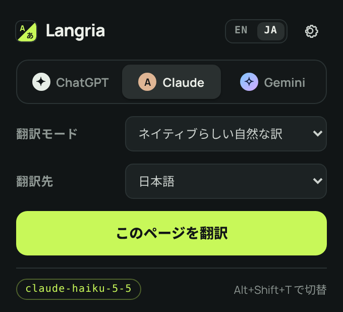

# Langria

[English](README.md) | 日本語

旧名は MyLingo です。

ChatGPT、Claude、Gemini を切り替えて使える、シンプルなブラウザ翻訳ツールです。英語・日本語をはじめ、好きな言語へ翻訳できます。次の3つがあります。

- **Webアプリ**: 入力・貼り付けた文章を翻訳します。<https://shigeya-t.github.io/Langria/app/> で試せます。インストールは不要で、ご自身のAPIキーを入力するだけで使えます。
- **Chrome拡張機能**: 表示中のWebページや選択した文章を翻訳します。[Chrome ウェブストア](https://chromewebstore.google.com/detail/nkoehfnflmidmigojnlfldmmgjnnkmoa?hl=ja)からインストールできます（[Chrome拡張機能](#chrome拡張機能webページ翻訳)を参照）。
- **iOSアプリ**: Webアプリと同じ翻訳に加え、カメラで撮った写真や選んだ写真の文字を読み取って翻訳します。Apple Watch でも使えます（[iOSアプリ](#iosアプリiphone--ipad)を参照）。

紹介ページ: <https://shigeya-t.github.io/Langria/ja.html>



## 特長

- 原文の言語は自動判別。翻訳先はドロップダウンで選択（初期値は、表示言語が日本語なら日本語、それ以外は英語）し、一覧にない言語は「その他」で自由に入力
- ChatGPT / Claude / Gemini の切り替え
- ライトモードとダークモードを切り替え可能
- 画面の表示言語は日本語と英語。ブラウザ（Chrome）の言語が日本語なら日本語、それ以外は英語で表示し、画面の小さな「EN / JA」スイッチで切り替え可能（選んだ言語は保存されます）
- 翻訳モードを選択可能（原文に忠実 / ネイティブらしい自然な訳 / ビジネス文書向け / 会話・SNS向け / 技術文書向け）
- 原文と翻訳の入れ替えボタン（両欄の内容と翻訳先の言語を入れ替え。原文の言語は文字の種類から推定するため、アルファベットの言語は英語とみなします。漢字だけの文は日本語か中国語か分からないため、訳文を入力欄に移して翻訳し直すだけです）
- 翻訳先や翻訳モードを切り替えると、すぐに翻訳し直し
- 入力から少し待つだけで自動翻訳（`⌘ / Ctrl + Enter` でも実行）
- APIキーとモデル名をブラウザの `localStorage` にだけ保存（APIキーはパスキーまたはパスフレーズで暗号化可能）
- ビルド不要の静的サイト。サーバーへデータを保存しません

## サーバーについて

アプリ本体にバックエンドサーバーは必要ありません。HTML、CSS、JavaScriptだけで動く静的サイトで、翻訳時はブラウザが各AIサービスのAPIへ直接アクセスします。

### 公開版

Webアプリは GitHub Pages で <https://shigeya-t.github.io/Langria/app/> に公開しています（`docs/` の紹介ページ・プライバシーポリシーと同じサイト）。`master` に push するたびに `.github/workflows/pages.yml` が `scripts/build-pages.sh` を実行し、`docs/` をサイトの直下に、下記のWebアプリのファイルを `app/` に置いて公開します（リポジトリの Pages の Source を「GitHub Actions」にしておく必要があります）。公開版では上部に「デモ用で、このリポジトリから自分用にセットアップできる」「APIキーは同じオリジンのほかのページから読み取れるため、暗号化か自分用のセットアップを勧める」という注意書きを出します（× で閉じると、そのブラウザでは以後表示しません）。リポジトリを自分で配信した場合は表示されません。

公開版で保存した設定は `https://shigeya-t.github.io` の `localStorage` に入り、同じアカウントのほかの GitHub Pages のサイトと共有されます。APIキーを守るため、パスキーかパスフレーズで暗号化する（[APIキーの暗号化](#apiキーの暗号化)）か、自分のサーバーに置いて使ってください。

### 必要なファイル

Webアプリは `index.html` 1つだけでは動きません。リポジトリをまるごと置くか、少なくとも次のファイルを同じフォルダ構成で置いてください。

| ファイル | 必須 | 役割 |
| --- | --- | --- |
| `index.html` | ○ | 画面 |
| `styles.css` | ○ | 見た目 |
| `app.js` | ○ | 翻訳処理の本体 |
| `extension/lib/i18n.js` | ○ | 画面の文言（日本語・英語。拡張機能と共用） |
| `extension/lib/vault.js` | ○ | APIキーの暗号化（拡張機能と共用） |
| `extension/lib/languages.js` | ○ | 翻訳先の言語一覧（拡張機能と共用） |
| `extension/icons/icon.svg` | | タブのアイコンとロゴ（拡張機能と共用） |
| `extension/lib/version.js` | | コミットハッシュの表示（git管理外。なくても動きます） |

フォントは Google Fonts から読み込みます。

### localhost で開く

`index.html` をファイルとして直接開いても使えますが、APIキーをパスキー（Touch ID など）で暗号化するには、https か `http://localhost` で開く必要があります。手元で使う場合は、リポジトリのフォルダで次のどちらかを実行し、ブラウザで `http://localhost:8000` を開いてください。

```sh
# Python（macOS には標準で入っています）
python3 -m http.server 8000 --bind 127.0.0.1

# Node.js
npx serve -l 8000
```

止めるときはターミナルで `Ctrl + C` を押します。

- アドレスは `http://127.0.0.1:8000` ではなく `http://localhost:8000` を使ってください。IPアドレスではパスキーを使えません。
- 設定（APIキーなど）は開き方ごとに別々に保存されます。ファイルとして開いていたときの設定は引き継がれないので、入力し直してください。ポート番号を変えた場合も同様です。

## 使い方

1. 使いたいサービス（ChatGPT / Claude / Gemini）を選択します。
2. 右上の設定（歯車）を開き、選択中のサービスのAPIキーを入力します。
3. 必要に応じてモデル名を変更し、「保存する」を押します。
4. 「原文」欄の左上で翻訳モードを選択します（省略時は「原文に忠実」）。
5. 上部のドロップダウンで翻訳先の言語を選びます（初期値は、表示言語が日本語なら日本語、それ以外は英語）。一覧にない言語は「その他…」を選んで言語名を入力します。
6. 左の欄に翻訳したい文章を入力します。原文の言語は自動で判別されます。

| サービス | 初期モデル |
| --- | --- |
| ChatGPT | `gpt-6-luna` |
| Claude | `claude-haiku-5-5` |
| Gemini | `gemini-3.5-flash-lite` |

### 表示言語

ブラウザの言語が日本語なら日本語、それ以外は英語で表示します。「EN / JA」スイッチ（Webアプリは右下、拡張機能はポップアップと設定画面の上部）で切り替えられ、選んだ言語はブラウザごとに保存されます。

### コミットハッシュの表示

Webアプリの設定パネルと拡張機能の設定画面の下部に、この GitHub リポジトリへのリンクと、動いているコードのコミットハッシュが表示されます。ハッシュは git フックが `extension/lib/version.js`（git管理外）に書き出すので、クローン後に一度だけ次を実行してください。以降はコミット・チェックアウト・pull のたびに自動で更新されます。

```sh
git config core.hooksPath .githooks && .githooks/write-version
```

## Chrome拡張機能（Webページ翻訳）

`extension/` フォルダには、表示中のWebページをまるごと翻訳するChrome拡張機能が入っています。Webアプリと同じく ChatGPT / Claude / Gemini を切り替えて使えます。



### 主な機能

- ツールバーのポップアップから「このページを翻訳」「原文に戻す」を切り替え
- 表示言語は Chrome の言語に合わせて日本語または英語。ポップアップと設定画面の「EN / JA」スイッチで切り替えると、右クリックメニューや選択翻訳の吹き出しにも反映（拡張機能の説明文とショートカットの説明は Chrome の言語に従います）
- ChatGPT / Claude / Gemini の切り替え、翻訳モードの選択（Webアプリと同じ5種類）
- 翻訳先はWebアプリと同じ一覧から選択（初期値は、表示言語が日本語なら日本語、それ以外は英語）し、一覧にない言語は「その他」で自由に入力
- 翻訳後にポップアップで翻訳先や翻訳モードを切り替えると、原文に戻してからすぐに翻訳し直し（ページ側が翻訳済みの文をコピー・再描画した部分も原文に戻します）
- 表示中の部分から順に翻訳し、スクロールに合わせて続きを順次翻訳（ページ全体を一度に送らないので速く、APIの消費も少ない）
- 「もっと見る」などで後から表示された内容も自動で翻訳
- 1分あたりのリクエスト数を制限でき、429（利用上限）エラー時はサービスが指定する待ち時間の後に自動で再試行。応答が時間内に返らないリクエストも再試行。サービスが翻訳を拒否した文（Gemini の安全フィルターなど）は原文のまま残し、ページの残りの翻訳は続ける
- テキストを選択して右クリック →「Langria で翻訳」で、選択部分だけを吹き出しに翻訳表示
- `Alt + Shift + T` で翻訳 / 原文に戻す を切り替え
- 入力欄・コードブロック・`translate="no"` / `.notranslate` の要素は翻訳しない

### インストール

1. [Chrome ウェブストア](https://chromewebstore.google.com/detail/nkoehfnflmidmigojnlfldmmgjnnkmoa?hl=ja)から Langria をインストールします。
2. ツールバーの Langria アイコン → 歯車から設定画面を開き、使うサービスのAPIキー（必要ならモデル名も）を入力して保存します。

拡張機能の設定は `chrome.storage.local` に保存されるため、Webアプリとは別に入力が必要です。プライバシーポリシーは [docs/privacy/](docs/privacy/ja.html)（公開URL: <https://shigeya-t.github.io/Langria/privacy/ja.html>）にあります。

#### リポジトリから読み込む（開発用）

ストア版ではなくこのリポジトリの最新のコードを試すときは、Chromeで `chrome://extensions` を開き、右上の「デベロッパーモード」をオンにして「パッケージ化されていない拡張機能を読み込む」を押し、このリポジトリの `extension` フォルダを選択します。APIキーは上の2と同じように入力します。

リポジトリを更新（pull・ブランチの切り替えなど）したら、`chrome://extensions` で Langria の再読み込みボタン（↻）を押してください。ポップアップや設定画面は開くたびに新しいファイルを読み込みますが、翻訳を行うバックグラウンド（Service Worker）は再読み込みするまで古いコードのまま動くため、食い違いでエラーになることがあります。再読み込みするとAPIキーの暗号化のロックも掛かり直します。

### Gemini の無料枠について

Gemini APIの無料枠には1分あたりのリクエスト数の上限（例: `gemini-3.5-flash-lite` は 15回/分）があります。拡張機能は初期設定ではリクエスト数を制限しません。上限に達したときは Gemini が指定する時間だけ待って自動で再試行し、それ以降は Gemini が知らせてきた上限を超えないよう等間隔で送ります（上限の数はブラウザを閉じるまで覚えています）。そのため止まるのは最初の1回だけです。設定画面の「1分あたりの最大リクエスト数」で自分で設定することもできます。1日あたりの上限に達した場合は、翌日まで待つか有料プランに切り替える必要があります。

### しくみ

ページのテキストを要素ごとに取り出し、画面内（と少し先）に入った部分だけを、画面に近い順にまとめてAIへ送って翻訳結果に差し替えます（HTMLの構造は変えません）。APIへの通信は拡張機能のバックグラウンド（Service Worker）から行うため、閲覧中サイトの設定に影響されません。ページへのアクセス権は `activeTab` のみで、翻訳を実行したタブにだけ一時的に許可されます。Shadow DOM（Webコンポーネント）の中と、同じサイトの iframe の中も翻訳します。別のサイトの iframe（埋め込み動画や広告など）は `activeTab` の権限が届かないため、そのままです。

## iOSアプリ（iPhone / iPad）

`ios/` フォルダーには、Webアプリと同じ機能に写真の文字の翻訳を加えた、iPhone・iPad 用の SwiftUI アプリ（iOS 17 以降）が入っています。

- Webアプリと同じ: ChatGPT / Claude / Gemini の切り替え、翻訳先の言語（「その他」を含む）、翻訳モード、入力して少し待つと自動で翻訳、入れ替えボタン、コピー、英語 / 日本語の表示（設定で選ばなければ端末の言語に従う）、ライト / ダーク
- **写真の文字を翻訳**: カメラのボタンで撮影するか、写真のボタンで写真を選びます。文字は端末の中（Apple の Vision）で読み取って原文欄に入れ、そのまま翻訳します（原文欄で直すこともできます）。行は段落にまとめ直すので、文の途中で切れずに翻訳されます。AIサービスへ送るのは文字だけで、画像は送りません
- **音声入力と読み上げ**: 原文欄のマイクのボタンで、話した言葉を文字にします（長押しで話す言語を選べます。最初は端末の言語）。言語が対応していれば認識は端末の中で行い、対応していなければキーボードの音声入力と同じく Apple の音声認識へ音声を送ります。翻訳欄のスピーカーのボタンで、訳文を翻訳先の言語のシステムの声で読み上げます（端末の中で行います）
- APIキーは端末のキーチェーン（同期しない項目）に保存します。設定の「**Face ID でロックを解除する**」をオンにすると、アプリを開くたびに Face ID（または Touch ID・パスコード）が必要になります。アプリが背面に回るとロックし直します
- ページの最後（翻訳欄の下）に Google AdMob のバナー広告を表示します。文章と一緒にスクロールします。法律で必要な地域では同意（Google の同意フォーム）を求め、続けてトラッキングの許可（App Tracking Transparency）を求めます。翻訳する文章を広告に使うことはありません。Debug ビルドでは Google のテスト広告が出ます
- **Apple Watch**: 設定の「**Apple Watch で使う**」をオンにすると、Apple Watch（watchOS 10 以降）でも翻訳できます。iPhone から APIキーと設定を送り、Apple Watch は自分のキーチェーンにキーの複製を保存して、AIサービスへ直接リクエストします。音声入力・手書き・キーボードで文章を入れ、翻訳先の言語を選び、訳文を読み上げられます。Apple Watch アプリが自動で入らないときは、iPhone の Watch アプリの「マイウォッチ」→「利用可能なApp」からインストールします（入るまで設定に案内を表示します）。オフにすると Apple Watch からキーを削除します。ロックがオンのときは、ロックを解除している間にキーを送ります
- 画面の文言と翻訳先の言語一覧は、Webアプリ・拡張機能と同じファイル（`extension/lib/i18n.js` と `languages.js`。`languages.js` には音声入力・読み上げに使う各言語のロケールも入っています）を JavaScriptCore で読み込んで使います

### ビルド

macOS の Xcode と [XcodeGen](https://github.com/yonaskolb/XcodeGen)（`brew install xcodegen`）が必要です。Xcode のプロジェクトは git に入れず、`ios/project.yml` から作ります。唯一の外部ライブラリである Google Mobile Ads SDK は Swift Package Manager で取得します。

1. `ios/` で `cp Local.xcconfig.example Local.xcconfig` し、`DEVELOPMENT_TEAM` を自分の Team ID にする（必要ならバンドルID `LANGRIA_BUNDLE_ID` もここで変える。Apple Watch アプリはこれに `.watchkitapp` を付けたもの）。`Local.xcconfig` は git に入らない
2. `ios/` で `xcodegen generate` を実行し、`Langria.xcodeproj` を開く。ファイルを足したり消したり、ブランチを切り替えたあとは作り直す
3. スキーム **Langria** を iPhone・iPad・シミュレーターで実行する。Apple Watch アプリも一緒にビルドされ、iPhone アプリに入る。シミュレーターで試すときは、Apple Watch のシミュレーターとペアリングした iPhone のシミュレーターを使う。テストは `xcodebuild test -project ios/Langria.xcodeproj -scheme Langria -destination 'platform=iOS Simulator,name=<シミュレーター名>'`

カメラのボタンは、カメラのある端末でだけ表示されます（シミュレーターでは出ません）。

## APIキーについて

このアプリはバックエンドを持たず、ブラウザから各AIサービスのAPIへ直接リクエストします。APIキーは `localStorage` に保存され、リポジトリに含まれることはありません。

### APIキーの暗号化

設定画面の「APIキーの暗号化」で、APIキーの保存方法を「暗号化しない（初期設定）」「パスキーで暗号化」「パスフレーズで暗号化」から選べます（Webアプリ・拡張機能とも）。あとから別の方法に変えることもできます（ロック解除中のみ）。

- **パスキー（Touch ID など）**: WebAuthn の PRF 拡張で認証器から暗号鍵を取り出します。Chrome 116 以降・Safari 18 以降で、対応する認証器が必要です。Webアプリは https（ドメイン名）または `http://localhost` で開いたときだけ使えます（`index.html` をファイルとして直接開いた場合は使えません）。
  - 1Password などのパスワード管理ツールは、拡張機能の設定画面（`chrome-extension://`）用のパスキーを保存できないことがあります（「パスキーを保存できません」と表示される。拡張機能の設定画面でパスキーを選ぶと、この注意書きが表示されます）。その場合は次のどれかを試してください。
    - パスワード管理ツールの画面でセキュリティキーなど別の方法を選び、ブラウザ標準の画面で Touch ID を使って作成する（パスキーは Chrome または iCloud キーチェーンに保存されます）。
    - 1Password の設定（ツールバーのアイコンを右クリック →「設定」→「自動入力と保存」）で「Offer to save and sign in with passkeys」（パスキーの保存とサインインを提案する項目）を一時的にオフにして作成する。ロック解除のときも同じ設定が必要になる場合があります。
    - パスフレーズで暗号化し、パスフレーズを 1Password に保管する。
- **パスフレーズ**: PBKDF2（SHA-256、60万回）で暗号鍵を作ります。パスキーを使えない環境向けです。

キーは AES-GCM で暗号化され、平文のキーは保存されなくなります。Webアプリはページを開くたびに、拡張機能はブラウザを起動するたびに（設定画面で）ロックの解除が必要です。拡張機能は解除したキーをブラウザを閉じるまで `chrome.storage.session`（メモリ上）に保持します。ロック中に翻訳しようとすると、そのままロック解除が始まり（パスキーなら認証画面、パスフレーズなら入力欄）、解除すると翻訳を続けます。Webアプリは翻訳欄で解除します。拡張機能は、パスフレーズならポップアップで、パスキーなら自動で開く小さな解除用ウィンドウで解除します（Chrome はパスキーの認証画面を出すとポップアップを閉じてしまうため）。パスキーをなくしたりパスフレーズを忘れたりすると復号できないため、キーそのものは 1Password やキーチェーンにも保管しておいてください。

暗号化で防げるのは、ブラウザの保存データを読まれたりコピーされたりした場合です。ロック解除中にページへ悪意あるスクリプトが入り込んだ場合（XSS）は防げません。

> **注意:** ブラウザアプリにAPIキーを保存する方式は、個人利用・ローカル利用を想定しています。
> `localStorage` はブラウザごとに分離されますが、公開サイトにするとコード改ざんやXSSが起きた際に全利用者のキーが一斉に漏洩するリスクがあります。

## ファイル構成

```
.
├── index.html   # 画面構造
├── styles.css   # レスポンシブなダーク/ライトUI
├── app.js       # 翻訳・設定・各API接続
├── README.md    # 英語版の README
├── README.ja.md # 日本語版の README（このファイル）
├── AGENTS.md    # AIコーディングエージェント向けの開発メモ
├── assets/      # README 用の画像
├── .githooks/   # コミットハッシュを version.js に書き出すフック
├── ios/         # iOSアプリ（SwiftUI。XcodeGen 用の project.yml、Langria/ にコード、LangriaWatch/ に Apple Watch アプリ、LangriaTests/ にテスト）
├── docs/        # 紹介ページとプライバシーポリシー（GitHub Pages で公開）
├── .github/     # workflows/pages.yml: docs/ とWebアプリを GitHub Pages に公開する
├── store/       # Chrome ウェブストアの掲載情報・画像・公開手順
├── scripts/     # package-extension.sh: ストア用の zip、build-pages.sh: GitHub Pages のサイトを作る
└── extension/   # Chrome拡張機能（Webページ翻訳）
    ├── manifest.json
    ├── background.js    # API呼び出し・右クリックメニュー・ショートカット
    ├── content.js       # ページ内テキストの抽出・差し替え・選択翻訳の吹き出し
    ├── popup.html/js    # ツールバーのポップアップ
    ├── options.html/js  # APIキー・モデルの設定画面
    ├── unlock.html/js   # パスキーでロック解除する小さなウィンドウ
    ├── ui.css
    ├── lib/
    │   ├── providers.js   # サービス設定・設定の読み込み
    │   ├── translator.js  # 翻訳リクエスト・レート制限・再試行
    │   ├── i18n.js        # 画面の文言（日本語・英語。Webアプリと共用）
    │   ├── vault.js       # APIキーの暗号化（Webアプリと共用）
    │   ├── languages.js   # 翻訳先の言語一覧（Webアプリと共用）
    │   └── version.js     # コミットハッシュ（git管理外・自動生成）
    ├── _locales/        # manifest の説明文（英語・日本語）
    └── icons/           # icon.svg（Webアプリのタブのアイコン・ロゴと共用）と PNG
```
