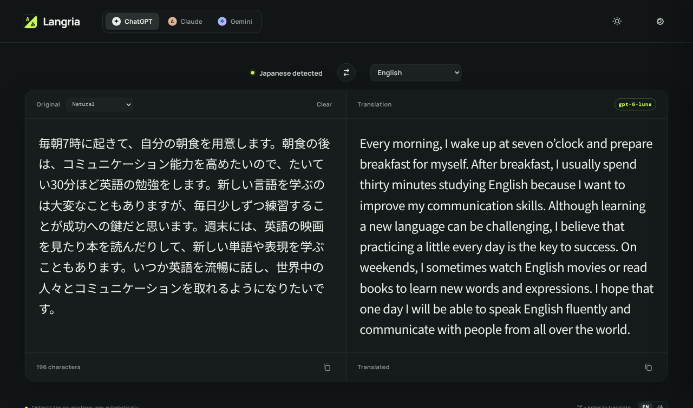
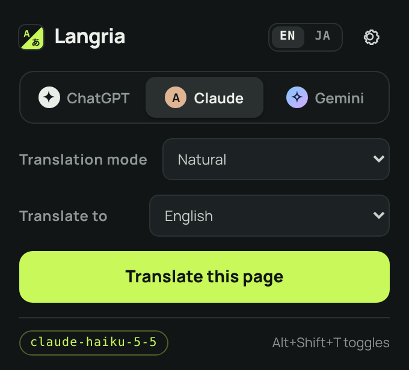

# Langria

English | [日本語](README.ja.md)

Formerly called MyLingo.

A simple browser translation tool that lets you switch between ChatGPT, Claude and Gemini. Translate into English, Japanese or any language you like. It comes in four forms:

- **Web app**: translates text you type or paste. Try it at <https://shigeya-t.github.io/Langria/app/> — no installation needed, just enter your own API key.
- **Chrome extension**: translates the web page you are viewing, or the text you select. Install it from the [Chrome Web Store](https://chromewebstore.google.com/detail/nkoehfnflmidmigojnlfldmmgjnnkmoa) (see [Chrome extension](#chrome-extension-page-translation)).
- **iOS app**: the web app’s translation on iPhone and iPad, plus reading and translating the text in photos you take or choose, and an Apple Watch app (see [iOS app](#ios-app-iphone--ipad)).
- **Android app**: the same as the iOS app on Android phones and tablets, without a watch app (see [Android app](#android-app)).

Project page: <https://shigeya-t.github.io/Langria/>



## Features

- Detects the source language automatically. Pick the target language from a dropdown (Japanese by default when the UI is in Japanese, English otherwise), or type any other language under "Other"
- Switch between ChatGPT / Claude / Gemini
- Light and dark mode
- Translation modes (Faithful / Natural / Business / Casual & social / Technical)
- A swap button (swaps the two panes and the target language; the source language is guessed from the script, so Latin-script text counts as English; kanji-only text could be Japanese or Chinese, so the swap then only moves the translation into the input and translates it again)
- Changing the target language or translation mode translates again right away
- Translates automatically shortly after you stop typing (or press `⌘ / Ctrl + Enter`)
- The UI is in English and Japanese: Japanese when your browser (Chrome) is set to Japanese, English otherwise. Switch with the small "EN / JA" toggle (your choice is remembered)
- API keys and model names are stored only in the browser's `localStorage` (API keys can be encrypted with a passkey or passphrase)
- A static site with no build step. Nothing is stored on a server

## About the server

The app needs no backend server. It is a static site made of HTML, CSS and JavaScript, and the browser calls each AI service's API directly when translating.

### Published version

The web app is published with GitHub Pages at <https://shigeya-t.github.io/Langria/app/>, next to the project page and privacy policy in `docs/`. On every push to `master`, `.github/workflows/pages.yml` runs `scripts/build-pages.sh`, which puts `docs/` at the site root and the web app files below under `app/`, and deploys the result (the repository's Pages source must be set to "GitHub Actions"). The published copy shows a notice at the top saying it is a demo you can set up for yourself from this repository, and that other pages on the same origin could read the API keys, so they should be encrypted or the app self-hosted (close it with × and it stays closed in that browser); the notice stays hidden when you serve the repository yourself.

Settings saved in the published version are stored in `localStorage` for `https://shigeya-t.github.io`, which is shared with any other GitHub Pages site under the same account. To keep API keys safe there, encrypt them with a passkey or passphrase (see [Encrypting API keys](#encrypting-api-keys)), or host the app yourself.

### Required files

The web app does not work with `index.html` alone. Deploy the whole repository, or at least the following files in the same folder layout.

| File | Required | Purpose |
| --- | --- | --- |
| `index.html` | ✓ | Page |
| `styles.css` | ✓ | Styles |
| `app.js` | ✓ | Translation logic |
| `extension/lib/i18n.js` | ✓ | UI text in English and Japanese (shared with the extension) |
| `extension/lib/vault.js` | ✓ | API key encryption (shared with the extension) |
| `extension/lib/languages.js` | ✓ | Target languages (shared with the extension) |
| `extension/icons/icon.svg` | | Tab icon and logo (shared with the extension) |
| `extension/lib/version.js` | | Shows the commit hash (not tracked by git; optional) |

Fonts are loaded from Google Fonts.

### Serving on localhost

You can open `index.html` directly as a file, but encrypting API keys with a passkey (Touch ID, etc.) requires https or `http://localhost`. To use it locally, run one of these in the repository folder and open `http://localhost:8000` in your browser.

```sh
# Python (preinstalled on macOS)
python3 -m http.server 8000 --bind 127.0.0.1

# Node.js
npx serve -l 8000
```

Press `Ctrl + C` in the terminal to stop it.

- Use `http://localhost:8000`, not `http://127.0.0.1:8000`. Passkeys do not work on IP addresses.
- Settings (API keys, etc.) are stored separately for each origin. Settings saved while the page was opened as a file are not carried over, so enter them again. The same applies when you change the port.

## Usage

1. Choose a service (ChatGPT / Claude / Gemini).
2. Open Settings (the gear at the top right) and enter the API key for the selected service.
3. Change the model name if needed and press "Save".
4. Choose a translation mode at the top left of the "Original" pane ("Faithful" by default).
5. Choose the target language from the dropdown at the top (Japanese by default when the UI is in Japanese, English otherwise). For a language not in the list, choose "Other…" and type its name.
6. Type the text to translate in the left pane. The source language is detected automatically.

| Service | Default model |
| --- | --- |
| ChatGPT | `gpt-6-luna` |
| Claude | `claude-haiku-5-5` |
| Gemini | `gemini-3.5-flash-lite` |

### UI language

The UI is shown in Japanese when the browser's language is Japanese and in English otherwise. The "EN / JA" toggle (at the bottom right of the web app, and at the top of the extension's popup and settings page) switches it; the choice is saved per browser.

### Showing the commit hash

The bottom of the web app's settings panel and the extension's settings page shows a link to this GitHub repository and the commit hash of the running code. A git hook writes it to `extension/lib/version.js` (not tracked by git), so run the following once after cloning. After that it updates automatically on every commit, checkout and pull.

```sh
git config core.hooksPath .githooks && .githooks/write-version
```

## Chrome extension (page translation)

The `extension/` folder contains a Chrome extension that translates the whole page you are viewing. Like the web app, it lets you switch between ChatGPT / Claude / Gemini.



### Features

- Toggle "Translate this page" / "Show original" from the toolbar popup
- The UI follows Chrome's language (Japanese or English). The "EN / JA" toggle in the popup and the settings page also changes the context menu and the selection bubble (the extension's description and the shortcut's description follow Chrome's language)
- Switch between ChatGPT / Claude / Gemini and choose a translation mode (the same five as the web app)
- Choose the target language from the same list as the web app (Japanese by default when the UI is in Japanese, English otherwise), or type any other language under "Other"
- Changing the target language or translation mode in the popup after translating restores the original and translates again right away (including text the page copied or re-rendered from the translation)
- Translates what is on screen first and the rest as you scroll (faster, and uses less of your API quota than sending the whole page at once)
- Also translates content that appears later, e.g. after "Show more"
- Limits requests per minute, and on a 429 (rate limit) error retries automatically after the wait the service asks for. A request that gets no reply in time is also retried. Text the service declines to translate (e.g. blocked by Gemini's safety filters) is left in the original language, and the rest of the page is still translated
- Select text, right-click and choose "Translate … with Langria" to see just that part translated in a bubble
- `Alt + Shift + T` toggles between translation and the original
- Does not translate input fields, code blocks, or elements marked `translate="no"` / `.notranslate`

### Installation

1. Install Langria from the [Chrome Web Store](https://chromewebstore.google.com/detail/nkoehfnflmidmigojnlfldmmgjnnkmoa).
2. Open the settings page from the Langria toolbar icon → gear, enter the API key (and model name if needed) for the services you use, and save.

The extension stores its settings in `chrome.storage.local`, so you need to enter them separately from the web app. The privacy policy is in [docs/privacy/](docs/privacy/index.html) (published at <https://shigeya-t.github.io/Langria/privacy/>).

#### Loading from the repository (development)

To try the latest code in this repository instead of the store version, open `chrome://extensions` in Chrome, turn on "Developer mode" at the top right, click "Load unpacked" and select this repository's `extension` folder. Then enter your API keys as in step 2 above.

After updating the repository (pull, switching branches, etc.), press Langria's reload button (↻) in `chrome://extensions`. The popup and settings page load the new files each time they open, but the background service worker that does the translating keeps running the old code until it is reloaded, and the mismatch can cause errors. Reloading also locks encrypted API keys again.

### About Gemini's free tier

Gemini API's free tier limits requests per minute (e.g. 15 per minute for `gemini-3.5-flash-lite`). The extension does not limit requests by default. When the limit is hit, it waits as long as Gemini asks, retries automatically, and from then on spaces its requests evenly to stay under the limit Gemini reports (kept until the browser closes), so only the first time pauses. You can also set "Max requests per minute" on the settings page. If you hit the daily limit, wait until the next day or switch to a paid plan.

### How it works

The extension extracts the page's text element by element and sends only the parts on screen (and a little beyond), closest to the viewport first, to the AI in batches, then replaces them with the translations (without changing the HTML structure). API calls are made from the extension's background service worker, so they are not affected by the site's settings. Page access is limited to `activeTab`, which is granted temporarily only to the tab you translate. Text inside Shadow DOM (web components) and inside frames from the same site is translated too; frames from other sites (embedded videos, ads, and the like) are left as they are, because `activeTab` does not reach them.

## iOS app (iPhone / iPad)

The `ios/` folder contains a SwiftUI app for iPhone and iPad (iOS 17 or later) with the same features as the web app, plus translating text from photos.

- Same as the web app: switching between ChatGPT / Claude / Gemini, target language (including “Other”), translation modes, automatic translation a moment after typing, the swap button, copying, the English / Japanese UI (follows the device unless chosen in Settings) and light / dark appearance
- **Translate text in photos**: take a photo with the camera button or pick one with the photo button. The text is read on the device (Apple’s Vision framework), put into the original pane where you can edit it, and translated. Lines are joined back into paragraphs so sentences are translated whole. Only the text is sent to the AI service, never the image
- **Voice input and reading aloud**: the microphone button in the original pane turns speech into text (pick the language you speak in the menu next to it; **Auto** listens in the device’s language, or in the other person’s — the last target — when translating into the device’s language, so the swap button switches it too). Recognition runs on the device when the language supports it; otherwise the audio goes to Apple’s speech recognition, as with keyboard dictation. The speaker button in the translation pane reads the translation aloud with the system voice for the target language, on the device
- API keys are stored in the device’s keychain (not synced). Turn on **Unlock with Face ID** in Settings to require Face ID (or Touch ID / the passcode) each time the app opens; the keys are locked again when the app moves to the background
- A banner ad from Google AdMob is shown at the end of the page, below the translation, and scrolls with it. The app asks for consent where the law requires it (Google’s consent form) and for permission to track (App Tracking Transparency); the text you translate is never used for ads. Debug builds show Google’s test ads
- **Apple Watch**: turn on **Use on Apple Watch** in Settings to use Langria on the watch (watchOS 10 or later). The iPhone sends the API keys and settings to the watch, which keeps a copy of the keys in its own keychain and calls the AI service directly. Speak, scribble or type the text, pick the target language, and have the translation read aloud. The dictation language is the watch’s own: swipe up from the bottom of the input screen to switch it (some languages offer no dictation on the watch; use voice input on iPhone for those). If the watch app is not installed automatically, install it in the iPhone’s Watch app (My Watch → Available Apps); Settings shows this until it is installed. Turning the setting off deletes the keys from the watch; with the lock on, the keys are sent while they are unlocked
- The UI text and the target language list are the same files as the web app and the extension (`extension/lib/i18n.js` and `languages.js`, which also holds each language’s locale for voice input and reading aloud), run in JavaScriptCore

### Building

You need macOS with Xcode and [XcodeGen](https://github.com/yonaskolb/XcodeGen) (`brew install xcodegen`). The Xcode project is not in git; it is generated from `ios/project.yml`. The only external library, the Google Mobile Ads SDK, is fetched by Swift Package Manager.

1. In `ios/`, run `cp Local.xcconfig.example Local.xcconfig` and set `DEVELOPMENT_TEAM` to your Team ID (change `LANGRIA_BUNDLE_ID` there too if needed; the watch app uses it with `.watchkitapp` added). `Local.xcconfig` is not committed
2. In `ios/`, run `xcodegen generate` and open `Langria.xcodeproj`. Regenerate after adding or removing files or switching branches
3. Run the **Langria** scheme on an iPhone, iPad or simulator. The Apple Watch app is built and embedded with it; to try it in the simulator, use an iPhone simulator paired with a watch simulator. Tests: `xcodebuild test -project ios/Langria.xcodeproj -scheme Langria -destination 'platform=iOS Simulator,name=<simulator>'`

The camera button appears only on devices with a camera (not in the simulator).

## Android app

The `android/` folder contains a Jetpack Compose app for Android phones and tablets (Android 11 or later) with the same features as the iOS app, except the watch app.

- Same as the iOS app: switching between ChatGPT / Claude / Gemini, target language (including “Other”), translation modes, automatic translation a moment after typing, the swap button, copying, translating text in photos (camera or the system photo picker), voice input with the language you speak (**Auto** works as on iOS) and reading aloud, the English / Japanese UI and light / dark appearance. On tablets and wide windows the panes sit side by side
- **Share to Langria**: text shared from another app, or picked with **Langria** in another app’s text selection menu, is put into the original pane and translated
- Text in photos is read on the device with Google’s ML Kit, whose models come with Google Play services (the Latin, Japanese, Chinese and Korean models each read the photo; the one that reads it best is used). Only the text is sent to the AI service, never the image
- Voice input uses the system’s speech recognition: on the device when the language’s model is installed, otherwise through the speech recognition service (Google’s, on most devices), as with keyboard voice typing. Reading aloud uses the system’s text to speech
- API keys are stored on the device only, encrypted with a key in the Android Keystore (not backed up). Turn on **Unlock with your fingerprint, face or screen lock** in Settings to require it each time the app opens; the keys are locked again when the app moves to the background
- A banner ad from Google AdMob is shown at the end of the page, as on iOS. The app asks for consent where the law requires it (Google’s consent form); Android has no tracking prompt. Debug builds show Google’s test ads
- The UI text and the target language list are the same files as the other apps (`extension/lib/i18n.js` and `languages.js`). The build copies them into the app, which reads them once in a WebView

### Building

You need JDK 17 or later and the Android SDK (Android Studio, or `brew install --cask android-commandlinetools`). The only external libraries are the Google Mobile Ads SDK (with UMP), ML Kit text recognition and AndroidX / Jetpack Compose, fetched by Gradle.

1. In `android/`, run `cp local.properties.example local.properties` and set `sdk.dir` (Android Studio does this when you open the folder). For a release build, also set the AdMob IDs of the Android app (`admob.appId`, `admob.bannerUnitId`) and the signing key there; without them the release build uses Google’s test ads and is unsigned. `local.properties` is not committed
2. Open `android/` in Android Studio and run the **app** configuration, or run `./gradlew installDebug` with a device or emulator connected
3. Tests: `./gradlew testDebugUnitTest` (the API calls go to a local stub server, so no API key is needed)

## About API keys

This app has no backend; the browser sends requests directly to each AI service's API. API keys are stored in `localStorage` and are never part of the repository.

### Encrypting API keys

Under "API key encryption" in Settings, choose how API keys are stored: "Do not encrypt" (default), "Encrypt with a passkey" or "Encrypt with a passphrase" (in both the web app and the extension). You can switch to another method later (only while unlocked).

- **Passkey (Touch ID, etc.)**: Uses the WebAuthn PRF extension to obtain an encryption key from the authenticator. Requires Chrome 116+ or Safari 18+ and a supporting authenticator. In the web app it only works over https (with a domain name) or at `http://localhost` (not when `index.html` is opened as a file).
  - Password managers such as 1Password sometimes cannot save a passkey for the extension's settings page (`chrome-extension://`) and report that the passkey cannot be saved (the extension's settings page shows a note about this when you choose a passkey). In that case, try one of the following:
    - In the password manager's dialog, choose another option such as a security key, and create the passkey with Touch ID in the browser's own dialog (it is saved in Chrome or iCloud Keychain).
    - In 1Password's settings (right-click the toolbar icon → "Settings" → "Autofill & save"), temporarily turn off "Offer to save and sign in with passkeys" while creating it. The same may be needed when unlocking.
    - Encrypt with a passphrase and keep the passphrase in 1Password.
- **Passphrase**: Derives the encryption key with PBKDF2 (SHA-256, 600,000 iterations). For environments where passkeys are not available.

Keys are encrypted with AES-GCM, and plaintext keys are no longer stored. The web app needs unlocking every time the page is opened, the extension every time the browser starts (on the settings page). The extension keeps unlocked keys in `chrome.storage.session` (in memory) until the browser closes. Trying to translate while locked starts unlocking right away (the authentication prompt for a passkey, an input field for a passphrase) and continues the translation once unlocked. The web app unlocks in the translation pane. The extension unlocks in the popup for a passphrase, and for a passkey in a small unlock window that opens automatically (Chrome closes the popup when it shows the passkey prompt). If you lose the passkey or forget the passphrase, the keys cannot be decrypted, so keep the keys themselves in 1Password or your keychain as well.

Encryption protects against the browser's stored data being read or copied. It does not protect against malicious scripts injected into the page while unlocked (XSS).

> **Note:** Storing API keys in a browser app is meant for personal, local use.
> `localStorage` is isolated per browser, but on a public site, tampered code or XSS could leak every user's keys at once.

## Files

```
.
├── index.html   # Page structure
├── styles.css   # Responsive dark/light UI
├── app.js       # Translation, settings and API calls
├── README.md    # README in English (this file)
├── README.ja.md # README in Japanese
├── AGENTS.md    # Development notes for AI coding agents
├── assets/      # Images for the README
├── .githooks/   # Hooks that write the commit hash to version.js
├── ios/         # iOS app (SwiftUI; project.yml for XcodeGen, Langria/ sources, LangriaWatch/ Apple Watch app, LangriaTests/)
├── android/     # Android app (Jetpack Compose; Gradle project, app/src/main sources, app/src/test unit tests)
├── docs/        # Project page and privacy policy (published with GitHub Pages)
├── .github/     # workflows/pages.yml: deploys docs/ and the web app to GitHub Pages
├── store/       # Chrome Web Store listing text, images and publishing steps
├── scripts/     # package-extension.sh: store zip; build-pages.sh: GitHub Pages site
└── extension/   # Chrome extension (page translation)
    ├── manifest.json
    ├── background.js    # API calls, context menu, shortcut
    ├── content.js       # Extracts and replaces page text, selection bubble
    ├── popup.html/js    # Toolbar popup
    ├── options.html/js  # Settings page for API keys and models
    ├── unlock.html/js   # Small window for unlocking with a passkey
    ├── ui.css
    ├── lib/
    │   ├── providers.js   # Service settings, loading settings
    │   ├── translator.js  # Translation requests, rate limiting, retries
    │   ├── i18n.js        # UI text in English and Japanese (shared with the web app)
    │   ├── vault.js       # API key encryption (shared with the web app)
    │   ├── languages.js   # Target languages (shared with the web app)
    │   └── version.js     # Commit hash (not tracked by git; generated)
    ├── _locales/        # Manifest descriptions (English and Japanese)
    └── icons/           # icon.svg (also the web app's tab icon and logo) and PNGs
```
